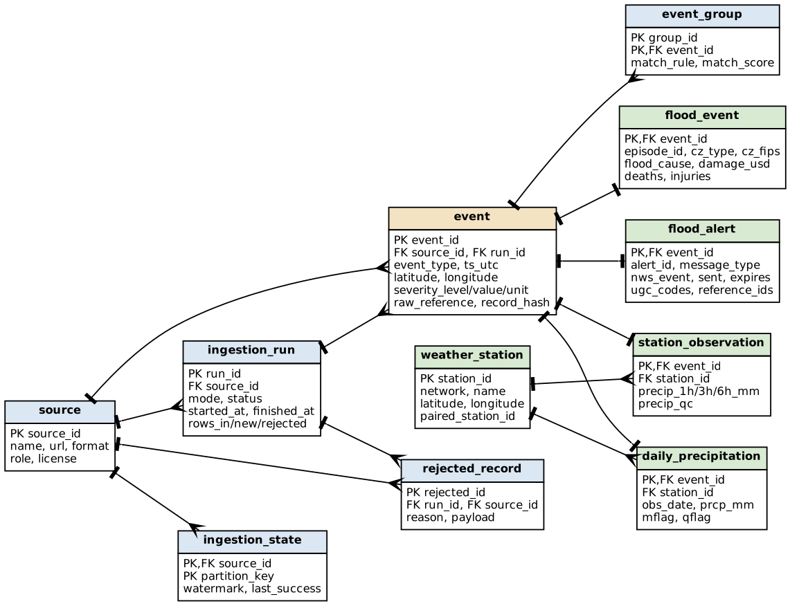

# ER diagram (first draft)

Source: `er_diagram.dot` (render with `dot -Tpng er_diagram.dot -o er_diagram.png`). DDL draft: `../sql/schema_draft.sql`.

- `event` holds one row per source record (canonical model); each row has exactly one domain row in `flood_event`, `daily_precipitation`, `station_observation` or `flood_alert`.
- `event_group` links records from different sources that describe the same real-world flood (e.g. a Storm Events flash flood + the GHCN station-day with heavy rain + the NWS warning).
- `weather_station` is a static entity shared by GHCN-Daily and NWS observations (`paired_station_id` links e.g. USW00012960 <-> KIAH).
